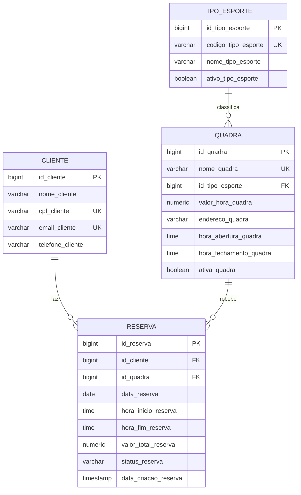

# eQuadras API — Agendamento de Quadras Esportivas

API REST para **reservar quadras esportivas** (futebol society, futsal, vôlei, beach tennis, tênis, basquete e padel) sem conflito de horários, com cálculo automático de valores e controle de cancelamentos e faturamento.

Projeto final da disciplina **Arquitetura Orientada a Serviços** — Java + Spring Boot + Spring Data JPA + PostgreSQL + Swagger.

---

## 1. O problema

Quem administra quadras esportivas costuma controlar os horários num caderno, numa planilha ou em conversas de WhatsApp. No dia a dia isso causa:

- **Reservas duplicadas**: dois grupos marcam o mesmo horário e descobrem só quando chegam à quadra.
- **Reservas impossíveis**: horário em que a quadra está fechada, em reforma ou que já passou.
- **Cancelamento em cima da hora**: o horário fica vazio e o dono perde dinheiro.
- **Erros de cobrança**: o valor é calculado à mão.
- **Nenhuma visão do faturamento** por quadra.

## 2. A solução

Um **serviço central** que guarda clientes, quadras e reservas num banco de dados e aplica as regras automaticamente. Qualquer aplicação pode consumir a API em JSON: um site, um app de celular, um bot de WhatsApp ou o sistema da recepção. Todas usam as mesmas regras, sem duplicar lógica.

```
 [ App do atleta ]   [ Bot WhatsApp ]   [ Sistema da recepção ]
          \                 |                  /
           \________ HTTP + JSON (REST) ______/
                            |
                   ┌──────────────────┐
                   │   eQuadras API   │  Controller → Service → Repository → Model
                   └──────────────────┘
                            |
                      [ PostgreSQL ]
```

## 3. Funcionalidades

- CRUD completo de **Clientes**, **Quadras** e **Reservas**, e gestão dos **Tipos de Esporte** (cadastrar, listar, ativar e inativar).
- Pesquisas por ID, CPF, nome, parte do nome, esporte, quadras ativas, data, status, cliente e quadra.
- **Tipos de esporte cadastráveis pela API** (ex.: incluir futevôlei sem mexer no código), com lista para qualquer aplicação montar seus filtros e formulários.
- **Grade de horários livres** de uma quadra num dia.
- **Cancelamento** e **remarcação** de reservas com política de antecedência.
- **Faturamento** por quadra, calculado a partir das reservas confirmadas.
- Validação de todos os dados recebidos (CPF, e-mail, telefone, valores, horários).
- Erros sempre no mesmo formato JSON, com mensagem clara e código HTTP correto.
- Documentação interativa no **Swagger**, com exemplos de requisição e resposta.
- Dados de exemplo cadastrados automaticamente na primeira execução.

## 4. Regras de negócio

| # | Regra | Resposta quando violada |
|---|---|---|
| RN01 | Quadra **inativa** (manutenção/reforma) não aceita reservas | 400 |
| RN02 | Reservas em **horas cheias**, com término depois do início (mínimo 1 h) | 400 |
| RN03 | **Não reservar no passado** | 400 |
| RN04 | Reserva **dentro do horário de funcionamento** da quadra | 400 |
| RN05 | **Impede duas reservas na mesma quadra no mesmo horário** (reservas encostadas, como 19–21 h e 21–22 h, são permitidas) | 409 |
| RN06 | O **mesmo cliente não pode ter duas reservas ao mesmo tempo** em quadras diferentes | 409 |
| RN07 | **Valor total calculado automaticamente** = valor da hora × horas (ignorado se vier no JSON) | — |
| RN08 | **Cancelar ou remarcar** só com pelo menos **2 horas de antecedência**; reserva cancelada não pode ser cancelada de novo nem remarcada | 400 |
| RN09 | Reserva cancelada **libera o horário** para outra pessoa | — |
| RN10 | Reserva **confirmada não pode ser excluída** (cancele antes) | 409 |
| RN11 | Cliente ou quadra **com reservas não podem ser excluídos** (a quadra deve ser inativada) | 409 |
| RN12 | **CPF, e-mail e nome da quadra únicos**; CPF gravado só com números (com ou sem máscara é o mesmo CPF) | 409 |
| RN13 | Quadra abre e fecha em horas cheias, com fechamento depois da abertura | 400 |
| RN14 | **Código do tipo de esporte único**, gravado em MAIÚSCULAS, sem acento e com `_` no lugar de espaço ("futevôlei" vira `FUTEVOLEI`) | 409 / 400 |
| RN15 | **Esporte inativo não pode ser usado em novas quadras** (as quadras que já existem continuam funcionando) | 400 |
| RN16 | Ativar um esporte já ativo, ou inativar um já inativo, é recusado | 400 |

**Concorrência:** a criação de reserva trava a linha da quadra no banco (*lock* pessimista, `SELECT ... FOR UPDATE`). Assim, se dois clientes pedirem o mesmo horário no mesmo instante, um espera o outro terminar e recebe 409, em vez de os dois conseguirem reservar.

## 5. Tecnologias

| Tecnologia | Uso |
|---|---|
| Java 21 | Linguagem |
| Spring Boot 4.1 (Spring MVC) | API REST |
| Spring Data JPA / Hibernate | Persistência e consultas (*Query Methods*) |
| PostgreSQL | Banco de dados relacional |
| Bean Validation / Hibernate Validator | Validação dos dados (inclui `@CPF`) |
| springdoc-openapi (Swagger UI) | Documentação |
| Lombok | Getters/setters automáticos |
| JUnit 5 + MockMvc + H2 | 33 testes automatizados das regras e endpoints |
| Maven (Maven Wrapper) | Build |

## 6. Arquitetura e organização

Camadas **Controller → Service → Repository → Model**, no mesmo padrão dos projetos da disciplina:

```
src/main/java/br/com/fatec/equadras/
├── EquadrasApplication.java
├── controller/   ClienteController, QuadraController, ReservaController, TipoEsporteController   → endpoints HTTP
├── service/      ClienteService, QuadraService, ReservaService, TipoEsporteService               → regras de negócio
├── repository/   ClienteRepository, QuadraRepository, ReservaRepository, TipoEsporteRepository   → acesso ao banco (JpaRepository + Query Methods)
├── model/        Cliente, Quadra, Reserva, TipoEsporte (entidades) + StatusReserva (enum)
│                 HorarioDisponivel, ResumoFaturamento (respostas de consulta)
├── exception/    GlobalExceptionHandler, ErroResposta, RegraNegocioException, RecursoNaoEncontradoException
└── config/       OpenApiConfig (Swagger), ExemplosApi, RelogioConfig, CargaInicialDados
```

### Modelo de dados



## 7. Como executar

### Pré-requisitos
- **JDK 21**
- **PostgreSQL** rodando em `localhost:5432`

### Passo a passo

1. Crie o banco de dados:
   ```sql
   CREATE DATABASE equadras;
   ```
2. Confira usuário e senha do PostgreSQL em `src/main/resources/application.properties` (padrão `postgres` / `123456`). Também dá para informar pelas variáveis de ambiente `DB_USUARIO` e `DB_SENHA`.
3. Rode a API:
   ```bash
   # Windows
   mvnw.cmd spring-boot:run

   # Linux / macOS
   ./mvnw spring-boot:run
   ```
4. Acesse:
   - **Swagger UI:** http://localhost:8080/swagger-ui.html
   - **OpenAPI (JSON):** http://localhost:8080/v3/api-docs

As tabelas são criadas automaticamente pelo Hibernate (`ddl-auto=update`). Na primeira execução, com o banco vazio, a API cadastra **7 tipos de esporte, 3 quadras, 2 clientes e 1 reserva** (amanhã das 19h às 21h na Arena Society 1) para a demonstração. Para desligar, use `equadras.carga-inicial=false`.

### Testes automatizados
```bash
mvnw.cmd test        # Windows
./mvnw test          # Linux / macOS
```
Os testes usam o banco em memória H2, com o "relógio" fixo em 10/01/2030 às 10:00. Não é preciso ter o PostgreSQL ligado para rodá-los.

## 8. Endpoints (32)

### Clientes — `/cliente`
| Método | Rota | Descrição | Sucesso |
|---|---|---|---|
| POST | `/cliente` | Cadastrar cliente | 201 |
| GET | `/cliente` | Listar todos | 200 |
| GET | `/cliente/id/{id}` | Pesquisar pelo ID | 200 |
| GET | `/cliente/cpf/{cpf}` | Pesquisar pelo CPF | 200 |
| GET | `/cliente/partenome/{nome}` | Pesquisar por parte do nome | 200 |
| PUT | `/cliente/{id}` | Atualizar | 200 |
| DELETE | `/cliente/{id}` | Excluir (se não tiver reservas) | 204 |

### Tipos de Esporte — `/tipo-esporte`
| Método | Rota | Descrição | Sucesso |
|---|---|---|---|
| POST | `/tipo-esporte` | Cadastrar tipo de esporte | 201 |
| GET | `/tipo-esporte` | Listar todos (código, nome e se está ativo) | 200 |
| PUT | `/tipo-esporte/ativar/{id}` | Ativar | 200 |
| PUT | `/tipo-esporte/inativar/{id}` | Inativar (não pode ser usado em novas quadras) | 200 |

### Quadras — `/quadra`
| Método | Rota | Descrição | Sucesso |
|---|---|---|---|
| POST | `/quadra` | Cadastrar quadra | 201 |
| GET | `/quadra` | Listar todas | 200 |
| GET | `/quadra/ativas` | Listar só as ativas | 200 |
| GET | `/quadra/id/{id}` | Pesquisar pelo ID | 200 |
| GET | `/quadra/nome/{nome}` | Pesquisar pelo nome exato | 200 |
| GET | `/quadra/partenome/{nome}` | Pesquisar por parte do nome | 200 |
| GET | `/quadra/esporte/{codigo}` | Pesquisar pelo código do esporte | 200 |
| PUT | `/quadra/{id}` | Atualizar (inclusive ativar/inativar) | 200 |
| DELETE | `/quadra/{id}` | Excluir (se não tiver reservas) | 204 |

### Reservas — `/reserva`
| Método | Rota | Descrição | Sucesso |
|---|---|---|---|
| POST | `/reserva` | Reservar (aplica todas as regras) | 201 |
| GET | `/reserva` | Listar todas | 200 |
| GET | `/reserva/id/{id}` | Pesquisar pelo ID | 200 |
| GET | `/reserva/cliente/{idCliente}` | Reservas de um cliente | 200 |
| GET | `/reserva/quadra/{idQuadra}` | Reservas de uma quadra | 200 |
| GET | `/reserva/data/{data}` | Reservas de um dia (`yyyy-MM-dd`) | 200 |
| GET | `/reserva/status/{status}` | Reservas por status (`CONFIRMADA`/`CANCELADA`) | 200 |
| GET | `/reserva/disponibilidade/{idQuadra}/{data}` | Grade de horários livres do dia | 200 |
| GET | `/reserva/faturamento/{idQuadra}` | Faturamento da quadra | 200 |
| PUT | `/reserva/{id}` | Remarcar (revalida tudo e recalcula o valor) | 200 |
| PUT | `/reserva/cancelar/{id}` | Cancelar | 200 |
| DELETE | `/reserva/{id}` | Excluir (só se cancelada) | 204 |

A carga inicial cadastra 7 tipos de esporte: `FUTEBOL_SOCIETY`, `FUTSAL`, `VOLEI`, `BEACH_TENNIS`, `TENIS`, `BASQUETE` e `PADEL`. Novos esportes podem ser cadastrados pela API. Na quadra, o esporte é informado pelo código (`"tipoEsporte": {"codigo": "PADEL"}`) ou pelo ID (`{"id_tipo_esporte": 7}`). Um código inexistente devolve `404` indicando `GET /tipo-esporte`.

## 9. Exemplos

### Cadastrar tipo de esporte — `POST /tipo-esporte`
```json
{
  "codigo": "futevôlei",
  "nome": "Futevôlei"
}
```
Resposta `201 Created` (o código é normalizado e o esporte nasce ativo):
```json
{ "id_tipo_esporte": 8, "codigo": "FUTEVOLEI", "nome": "Futevôlei", "ativo": true }
```

### Cadastrar quadra — `POST /quadra`
```json
{
  "nome": "Arena Society 1",
  "tipoEsporte": { "codigo": "FUTEBOL_SOCIETY" },
  "valorHora": 150.00,
  "endereco": "Rua das Palmeiras, 100 - Centro",
  "horaAbertura": "08:00",
  "horaFechamento": "23:00"
}
```

### Cadastrar cliente — `POST /cliente`
```json
{
  "nome": "Arthur Prado",
  "cpf": "52998224725",
  "email": "arthur@email.com",
  "telefone": "11987654321"
}
```

### Reservar — `POST /reserva`
Basta informar o ID do cliente e da quadra:
```json
{
  "cliente": { "id_cliente": 1 },
  "quadra": { "id_quadra": 1 },
  "data": "2026-11-30",
  "horaInicio": "19:00",
  "horaFim": "21:00"
}
```
Resposta `201 Created` (o valor, o status e a data de criação são preenchidos pela API):
```json
{
  "id_reserva": 1,
  "cliente": { "id_cliente": 1, "nome": "Arthur Prado", "cpf": "52998224725", "email": "arthur@email.com", "telefone": "11987654321" },
  "quadra": { "id_quadra": 1, "nome": "Arena Society 1", "tipoEsporte": { "id_tipo_esporte": 1, "codigo": "FUTEBOL_SOCIETY", "nome": "Futebol Society", "ativo": true }, "valorHora": 150.00, "endereco": "Rua das Palmeiras, 100 - Centro", "horaAbertura": "08:00", "horaFechamento": "23:00", "ativa": true },
  "data": "2026-11-30",
  "horaInicio": "19:00",
  "horaFim": "21:00",
  "valorTotal": 300.00,
  "status": "CONFIRMADA",
  "dataCriacao": "2026-11-21T14:30:00"
}
```

### Horário ocupado — `409 Conflict`
```json
{
  "dataHora": "2026-11-21T14:30:00",
  "status": 409,
  "erro": "Conflict",
  "mensagem": "Horário indisponível: a quadra já está reservada das 19:00 às 21:00 nesta data.",
  "caminho": "/reserva"
}
```

### Dados inválidos — `400 Bad Request`
```json
{
  "dataHora": "2026-11-21T14:30:00",
  "status": 400,
  "erro": "Bad Request",
  "mensagem": "Dados inválidos. Corrija os campos indicados.",
  "caminho": "/cliente",
  "campos": [
    { "campo": "cpf", "mensagem": "CPF inválido." },
    { "campo": "email", "mensagem": "E-mail inválido (email@email.com)" }
  ]
}
```

### Grade do dia — `GET /reserva/disponibilidade/1/2026-11-30`
```json
[
  { "horaInicio": "18:00", "horaFim": "19:00", "disponivel": true,  "situacao": "Livre" },
  { "horaInicio": "19:00", "horaFim": "20:00", "disponivel": false, "situacao": "Reservado" },
  { "horaInicio": "20:00", "horaFim": "21:00", "disponivel": false, "situacao": "Reservado" },
  { "horaInicio": "21:00", "horaFim": "22:00", "disponivel": true,  "situacao": "Livre" }
]
```

## 10. Códigos de retorno

| Código | Quando |
|---|---|
| 200 OK | Consulta, atualização, cancelamento |
| 201 Created | Cadastro realizado |
| 204 No Content | Exclusão realizada |
| 400 Bad Request | Campos inválidos, JSON mal formado ou regra de negócio violada |
| 404 Not Found | ID/CPF/nome inexistente ou rota inexistente |
| 409 Conflict | Horário já reservado, dado duplicado ou exclusão de registro com reservas |
